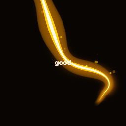

# finance-animation

Animated XLK (Technology Select Sector SPDR) status GIF for a GitHub profile README.
The animation's state (good / neutral / bad) is driven by XLK's daily price change,
and the status GIF is refreshed automatically.

## Current status



State: see [`assets/xlk-state.json`](assets/xlk-state.json).

## How it works

1. `scripts/fetch_and_update_xlk.py` fetches the latest XLK close, computes the
   percentage change, classifies it as `good` (≥ +0.5%), `bad` (≤ -0.5%), or
   `neutral`, and writes the state to `assets/xlk-state.json`.
2. If the matching base GIF is missing, `scripts/capture_xlk_gifs.js` renders it
   from `fiery_physarum_simulation.html` via Playwright + ffmpeg.
3. The selected state GIF is copied to `assets/xlk-status.gif`.

## Run locally

```bash
npm install
npx playwright install chromium
# ffmpeg must be on PATH
npm run update
```

Or the combined runner:

```bash
./scripts/run.sh
```

## Automatic refresh

`.github/workflows/update-xlk.yml` runs hourly (best effort) and on manual
dispatch: it re-runs the update and commits changed GIFs back to `main`.

## Using in your own repos

See [`examples/profile-workflow.yml`](examples/profile-workflow.yml) and the
composite action defined in [`action.yml`](action.yml).

## License

ISC